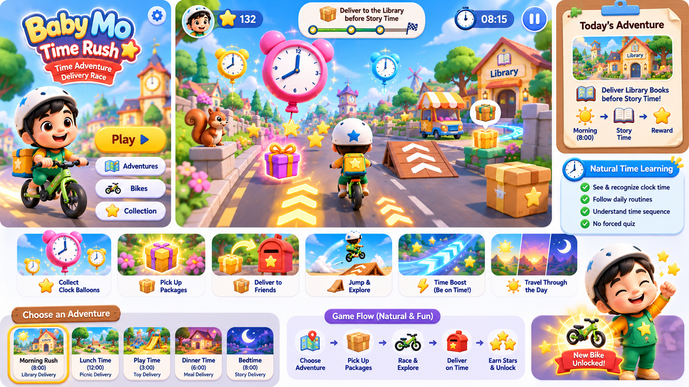

# Baby Mo Time Rush — Adventure Delivery · Game Design Document

**Ages:** 4–8 · **Platforms:** phone/tablet web (PWA), desktop · **Languages:** Bahasa Indonesia + English · **Session:** 3–5 min per delivery

## 1. Pitch
Baby Mo rides his little green balance bike through storybook towns delivering packages to friends. The day moves on as he rides: the town clock, the clock balloons and the sky all show the time, so children *live* the time instead of being quizzed on it. Nobody ever fails: bumps are giggly wobbles, missed stars come round again, and every delivery ends in a celebration.

## 2. Design pillars
1. **Joy of motion** — auto-forward riding, big friendly jumps, rainbow boosts.
2. **Time is the world** — clocks are everywhere and always correct; time moves with progress, not with a countdown.
3. **No stress** — no timers to beat, no lives, no game-over, no ads, no purchases.
4. **Kindness** — helping animal friends is always worth a detour.
5. **Readable for a 4-year-old** — three lanes, huge targets, icons over words, voice for key moments.

## 3. Core loop
Mission card (who needs what, by when) → ride → collect stars & clock balloons → pick up the package → optional shortcut / friend → arrive → delivery animation → rewards (stars → bikes, helmets, bags) → next mission or replay.

## 4. Controls
| Action | Touch | Keyboard | Notes |
|---|---|---|---|
| Steer | tap / hold left or right half; or swipe | ← → / A D | 3 lanes, smooth lane change (0.25 s) |
| Jump | tap the big Jump button or swipe up | Space / ↑ / W | ramps launch an automatic big jump |
| Boost | automatic on rainbow pads & rings | — | no button to mash |
| Pause | ⏸ top-right | Esc / P | |
Riding is automatic. Speed eases up to cruise; boosts add +45% for 2 s.

## 5. Mechanics
- **Riding:** speed 0 → cruise in ~2 s with scoot animation (balance bikes have no pedals; Mo pushes with his feet, then glides).
- **Collisions (no fail):** boxes, toy blocks and logs cause a 0.6 s wobble and −30% speed; Mo puts a foot down and giggles. Puddles splash and slow −15%.
- **Jumps:** tap jump = small hop (clears logs and puddles). Ramps = big jump with star arcs in the air.
- **Collectibles:** stars (1), coins (1, count as stars in the slice), gift boxes (5 stars + sparkle), clock balloons (signature), adventure token (one per world, from the friend quest), hidden surprises (floating pocket clock in the shortcut).
- **Clock balloons:** each shows a time close to "now" in the story (e.g. 8:15 when the story clock reads 8:15). Collecting one makes Mo say the time ("It's quarter past eight!") — sparing, max one voice line per 8 s.
- **Packages:** 3 pickup stations (book bundles) on the route; each one rides into Mo's backpack (pickup animation). The HUD shows 0/3 → 3/3.
- **Shortcut:** a paper-tunnel arch in the right lane at ~40% of the route skips a section; inside are bonus stars and the hidden pocket clock.
- **Friend:** a bunny waves from the roadside; carrots appear in the next stretch; collecting 3 carrots gives them back (help cut-in), and the bunny gives the adventure token.
- **Time of day:** story clock 8:00 → 9:00 mapped to route progress; sky warms from early morning gold to bright morning blue, sun climbs; the clock tower and HUD clock always agree.
- **Arrival:** library door opens, Mo hands over the books, the librarian smiles, confetti. Arrival time on the tower: "We made it at nine o'clock — just when the library opens!". No "late" state — the story time is always right on time.

## 6. Worlds
| # | World | Time | Delivery | Status |
|---|---|---|---|---|
| 1 | **Morning Town** | 8:00 → 9:00 | Books to the library | **Vertical slice** |
| 2 | Sunny Park | 12:00 | Picnic basket | Coming soon |
| 3 | Playtime Village | 3:00 | Toy train to the toy shop | Coming soon |
| 4 | Sunset Town | 6:00 | Dinner to grandma's house | Coming soon |
| 5 | Dreamland | 8:00 pm | Teddy bear at bedtime | Coming soon |
Worlds unlock in order by finishing the previous delivery (the parent can unlock all).

## 7. Morning Town route (≈ 100 s at cruise, ≈ 75 s with the shortcut)
Start (3-2-1 Go! under the flag arch, bakery, clock tower 8:00) → star trails → pickup 1 → log + first ramp → puddles → **bunny** → carrots → **shortcut tunnel / main road with bridge** → pickup 2 → boost pad + rainbow ring → box & block slalom → pickup 3 → final ramp star arc → finish arch → library (9:00). Animal friends from the app-ayah library (puppy, kitten, duckling, chick, lamb, hamster, cow, turtle) cheer along the whole road.

## 8. Rewards & progression
- Stars persist across rides. Results: 1–3 stars-of-praise (always ≥1: "delivered"; 2 for ≥50% of the stars on the route; 3 for ≥80% or for helping the bunny).
- Stars are never spent; unlocks open at lifetime star totals (a good ride earns 150–250): bikes Sky blue 150, Sunny yellow 300, Soft pink 500, Lavender 750, Rainbow Glider 1000; helmets 200/400/650; bags 250/550.
- Accessory collection screen shows locked items as silhouettes with the star count needed.

## 9. Screens
Splash · Main menu · Adventure selection (5 world cards) · Mission intro (clipboard card) · HUD (stars, packages, clock, pause) · Pause · Delivery completion · Rewards · Bike garage · Accessory collection · World unlock · Parent settings (gate).

## 10. Audio & voice
Gentle music-box style SFX from the shared platform (`tap pop star correct whoosh fanfare`); voice uses the shared `speak()` (recorded Baby Mo voice when available, TTS fallback), sparing: mission intro, each pickup, each clock balloon (time spoken), friend, arrival.

## 11. Child safety & accessibility
No third-party data or network calls; no external links or sharing (parental gate in Parent settings only); reduced motion respects the OS setting and a parent toggle (disables camera shake, speed lines); colour-blind-safe collectible shapes (star/balloon/box differ by silhouette); left-handed layout swap; all text EN/ID; dark-mode UI chrome.

## 12. Out of scope for the slice
Worlds 2–5 gameplay, generated art (placeholders until the prompt library is produced), online anything.
