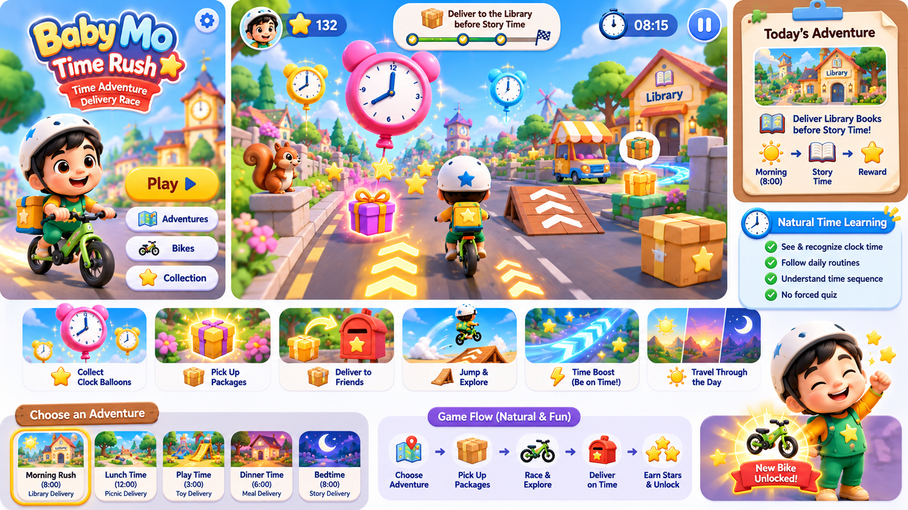

# Baby Mo Time Rush — Visual Asset Bible

> Generated from `src/rush/assets/packs.ts` by `npm run docs:rush`. Edit the packs, not this file.

## 1. Style
RENDER STYLE: premium 3D animated children's-movie render (original character design, not imitating any studio), soft clay-like matte materials with gentle subsurface glow, rounded friendly shapes, chibi proportions, soft ambient occlusion, warm morning key light from the upper left (about 45°), soft cool fill light from the right, subtle rim light, gentle bloom on bright highlights. Colour palette: fresh green #4CBF5A, orange-peach #FF9E6B, sunny yellow #FFD23F, sky blue #7FCAFF, soft lavender #B8A5FF, warm cream #FFF6E3. Crisp, clean edges, high detail but uncluttered, no outlines, no painterly brush strokes, no film grain.

## 2. Baby Mo
CHARACTER — BABY MO (must match the attached reference exactly):
- Cute toddler boy, about 3 years old, chibi proportions: about 3.2 heads tall, the head is large (about 40% of total height), round face, round soft cheeks with a light rosy blush.
- Hair: short, slightly messy, glossy black hair with a few soft tufts on top and a soft fringe sweeping to his left; never long, never spiky, never brown.
- Eyes: big, round, glossy dark-brown eyes with two white catch-lights each, short dark lashes, soft brown eyebrows.
- Skin: light warm skin tone (peach-beige), small button nose, small smiling mouth.
- Outfit: one-piece bright fresh-green jumpsuit (#4CBF5A) with a small light-grey five-point star on the centre of the chest, a thin orange-peach band across the belly, long orange-peach sleeves (#FF9E6B) with thin yellow cuffs at the wrists, green rounded shoes matching the jumpsuit.
- Body: short chubby arms and legs, small hands with four fingers and a thumb, no visible neck.
NEVER change his face shape, eye size, hair style, skin tone, clothing colours, star position or shoe design. No extra accessories unless this prompt asks for them.

**Helmet.** HELMET (worn in all riding assets): a smooth rounded white bicycle helmet sized for a toddler, with a soft-blue five-point star on the forehead and two thin light-blue vent stripes running front to back, a white chin strap with a small orange buckle. The helmet sits snugly on top of his black hair; the fringe and side hair stay visible under the front and sides.

**Render 1 first** (owner rule): the real-render series `babymo-app/www/baby-mo-poses/` (800×800 PNG) is the identity reference for every Baby Mo prompt. Until the new art exists, the game uses render-1 `baby-mo-pose-38.png` (from behind), cut at the waist, on a procedurally drawn push balance bike. Render 2 and the old "Kata Baik" poses are not used.

## 3. Push balance bike
PUSH BALANCE BIKE (a pedal-less push bike / run bike for toddlers — must match the attached bike reference exactly):
- It is a PUSH BIKE: there are NO pedals, NO crank arms, NO chain, NO chainring, NO gears and NO training wheels. The child sits on the saddle and pushes along the ground with his own feet (walking / running strides), then lifts his feet and glides. Small flat grey footrests on each side of the lower frame are only for resting the feet while gliding — they are NOT pedals and do not turn.
- Frame: a smooth rounded tube frame in fresh green (#4CBF5A) with a cream-white accent stripe, a low slung shape like a gentle "V".
- Wheels: two equal 12-inch wheels with chunky soft-grey rubber tyres, cream-white rims and five rounded spokes, a small yellow star cap on each wheel hub.
- Handlebar: rounded swept-back handlebar with soft orange grips and a small yellow bell on the right side.
- Seat: a small padded saddle in orange-peach (#FF9E6B), low enough that the toddler's feet touch the ground flat.
- Proportions: the bike is about as tall as Baby Mo's hip; wheelbase about 1.3 times Baby Mo's height.

The brief's "pedalling" is shown as **push-off strides** with the feet on the ground (`mo-push`) and **gliding** with the feet on the footrests (`mo-ride-loop`).

## 4. Image rules
- **Six per image:** every image is 1536 × 1024 with a 3 × 2 grid of 512 × 512 cells — six poses, six items, or the six frames of one animation (the logo is the only single image).
- **PNG with a transparent background** for every image. Sky and road are painted by the game.
- **Gameplay camera:** CAMERA: gameplay chase view — seen from directly behind and slightly above, camera about 1.5 m behind and 1.2 m up, looking down about 15°; Baby Mo and the bike face AWAY from the viewer, riding into the image; centred horizontally; a slight three-quarter hint is allowed only when the frame describes turning.
- **Never paint the time.** Clock faces (balloons, tower, pocket clock, icons) are BLANK; the game draws hands that always show the right time.
- **Same scale in every cell**, characters and props on a ground line ~92% down the cell; the slicer aligns them on that line.

## 5. Kit reuse (app-ayah visual library)
Buttons, panels, coins, gifts, chests, stars, ribbons and village pieces from the app-ayah art library are in `public/rush/kit/` and are used until the matching pack is generated.

## 6. Pipeline
1. Generate with the prompt in `04-PROMPT-LIBRARY.md` → save `art-src/rush/<pack>.png`.
2. `python3 scripts/rush-slice.py art-src/rush/<pack>.png` cuts the grid, removes a white backdrop if there is one, trims, aligns the ground line and writes `public/rush/art/<id>.webp` per item (or one strip per animation clip) plus `public/rush/art/atlas.json`.
3. The game uses the new art automatically; anything missing keeps its placeholder.

## 7. Packs (37 images: 23 done or covered, 14 to make, 6 of them now)

### References

| # | image | status | kind | game files |
|---|---|---|---|---|
| 1 | Baby Mo reference poses (with helmet) | ✅ done | poses | `mo-ref-front`, `mo-ref-34`, `mo-ref-side`, `mo-ref-back`, `mo-stand-front`, `mo-stand-back` |
| 2 | Push balance bike reference views | ✅ done | items | `bike-side`, `bike-34`, `bike-front`, `bike-rear`, `bike-wheel`, `bike-detail` |
| 3 | Riding key poses (approve before any animation) | 📚 already covered | poses | `mo-ride-34`, `mo-ride-side`, `mo-ride-front`, `mo-idle-rear`, `mo-push-side`, `mo-bag-side` |

### Riding animations

| # | image | status | kind | game files |
|---|---|---|---|---|
| 4 | Gliding loop | ✅ done | anim | `mo-ride-loop` (frames 1–6, 10 fps, loop) |
| 5 | Push-off strides loop (feet push the ground — no pedals) | 📚 already covered | anim | `mo-push` (frames 1–6, 12 fps, loop) |
| 6 | Turning left and right | 📚 already covered | anim | `mo-lean-left` (frames 1–3, 12 fps), `mo-lean-right` (frames 4–6, 12 fps) |
| 7 | Jump: crouch, fly, land | ⭐ NOW | anim | `mo-jump-prep` (frames 1–2, 12 fps), `mo-jump-air` (frames 3–4, 6 fps, loop), `mo-land` (frames 5–6, 12 fps) |
| 8 | Speed boost loop | ⭐ NOW | anim | `mo-boost` (frames 1–6, 12 fps, loop) |
| 9 | Catching a package | ⭐ NOW | anim | `mo-pickup` (frames 1–6, 10 fps) |
| 10 | Gliding with a full backpack | 📚 already covered | anim | `mo-ride-carry` (frames 1–6, 10 fps, loop) |
| 11 | Gentle bump and recovery (never falls) | ⭐ NOW | anim | `mo-wobble` (frames 1–6, 10 fps) |
| 12 | Waiting on the bike (idle loop) | 📚 already covered | anim | `mo-idle-bike` (frames 1–6, 6 fps, loop) |
| 13 | Looking around and waving to friends | later | anim | `mo-look` (frames 1–3, 8 fps), `mo-wave-ride` (frames 4–6, 8 fps) |

### Baby Mo cut-scenes

| # | image | status | kind | game files |
|---|---|---|---|---|
| 14 | Face portraits for the HUD and speech bubbles | 📚 already covered | poses | `mo-face-happy`, `mo-face-blink`, `mo-face-surprised`, `mo-face-excited`, `mo-face-thinking`, `mo-face-proud` |
| 15 | Delivery celebration | ⭐ NOW | anim | `mo-celebrate` (frames 1–6, 8 fps) |
| 16 | Helping the squirrel | later | anim | `mo-help` (frames 1–6, 6 fps) |

### Bikes & gear

| # | image | status | kind | game files |
|---|---|---|---|---|
| 17 | Bike colours | ✅ done | items | `bike-green`, `bike-blue`, `bike-yellow`, `bike-pink`, `bike-lavender`, `bike-rainbow` |
| 18 | Delivery backpacks | 📚 already covered | items | `bag-yellow`, `bag-blue`, `bag-pink`, `bag-books`, `bag-picnic`, `bag-moon` |
| 19 | Packages to deliver | 📚 already covered | items | `pkg-storybooks`, `pkg-gift`, `pkg-picnic`, `pkg-toy`, `pkg-food`, `pkg-teddy` |
| 20 | Helmet colours | later | items | `helmet-white`, `helmet-blue`, `helmet-yellow`, `helmet-mint`, `helmet-lavender`, `helmet-orange` |
| 21 | Bike accessories | 📚 already covered | items | `acc-bell`, `acc-basket`, `acc-streamers`, `acc-flag`, `acc-light`, `acc-beads` |

### Morning Town

| # | image | status | kind | game files |
|---|---|---|---|---|
| 22 | Town buildings | later | items | `library`, `tower`, `bakery`, `shop`, `house`, `house2` |
| 23 | Trees | 📚 already covered | items | `tree`, `tree2`, `tree3`, `tree4`, `tree5`, `tree6` |
| 24 | Roadside things | 📚 already covered | items | `bush`, `flowers`, `lamp`, `fence`, `bench`, `mailbox` |
| 25 | Sky things | 📚 already covered | items | `cloud1`, `cloud2`, `cloud3`, `bird-1`, `bird-2`, `sun` |
| 26 | World cards (floating dioramas) | 📚 already covered | items | `world-morning`, `world-park`, `world-play`, `world-sunset`, `world-dream`, `world-key` |

### On the road

| # | image | status | kind | game files |
|---|---|---|---|---|
| 27 | Things to collect | 📚 already covered | items | `star`, `coin`, `gift`, `token`, `pocketclock`, `acorn` |
| 28 | Clock balloons (blank faces) | later | items | `balloon-0`, `balloon-1`, `balloon-2`, `balloon-3`, `balloon-4`, `balloon-5` |
| 29 | Soft obstacles and road pieces | ⭐ NOW | items | `log`, `boxes`, `blocks`, `puddle`, `ramp`, `boost` |
| 30 | Arches, tunnel and rings | later | items | `pickup`, `tunnel`, `paper-arch`, `arch-start`, `ring`, `rainbow` |

### Friends

| # | image | status | kind | game files |
|---|---|---|---|---|
| 31 | Squirrel friend | 📚 already covered | poses | `squirrel`, `squirrel-sad`, `squirrel-happy`, `squirrel-hug`, `squirrel-wave`, `squirrel-home` |
| 32 | The librarian | later | poses | `librarian`, `librarian-wave`, `librarian-receive`, `librarian-books`, `librarian-door`, `librarian-read` |
| 33 | More town friends | 📚 already covered | poses | `rabbit`, `rabbit-happy`, `bird`, `baker`, `baker-wave`, `postman` |

### Screens & effects

| # | image | status | kind | game files |
|---|---|---|---|---|
| 34 | Game logo | later | items | `logo` |
| 35 | Menu and HUD icons | 📚 already covered | items | `icon-clock`, `icon-package`, `icon-map`, `icon-bike`, `icon-trophy`, `icon-garage` |
| 36 | Screen props | 📚 already covered | items | `ui-clipboard`, `ui-chest`, `ui-banner`, `ui-turntable`, `ui-wardrobe`, `ui-library-door` |
| 37 | Effects | 📚 already covered | items | `fx-sparkle`, `fx-dust`, `fx-confetti`, `fx-hearts`, `fx-splash`, `fx-pop` |
